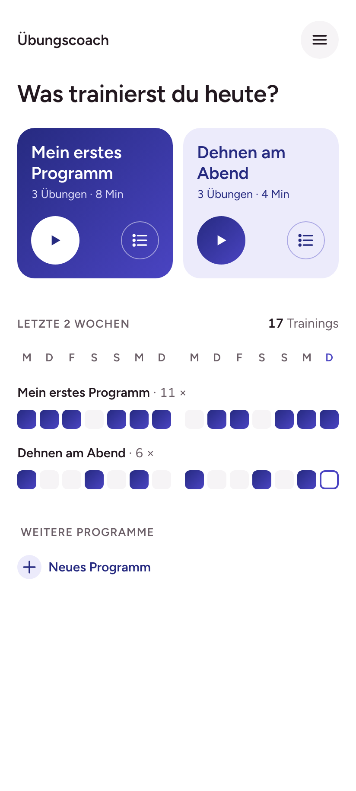
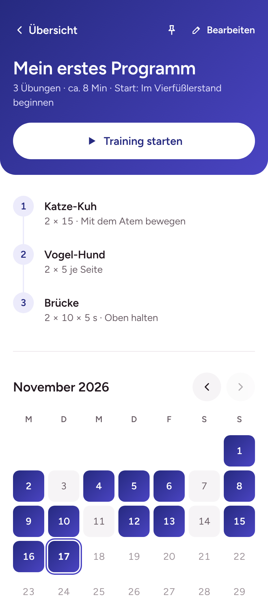
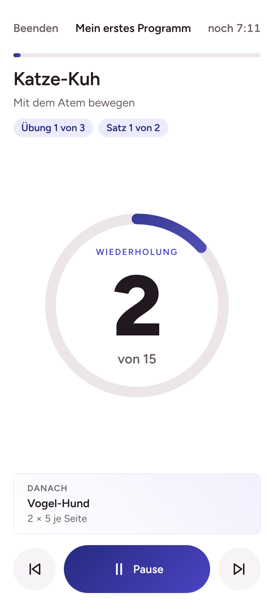

# Übungscoach
**Eine Web-App, die mich durch meine Übungen führt, damit ich nicht aufs Handy schauen muss.** Sie kündigt jede Übung an, zählt Wiederholungen mit oder Haltezeiten herunter und geht von selbst zur nächsten Übung weiter. Je nach Einstellung geschieht das mit Signaltönen oder mit Sprachansage.

## TL;DR
- **Problem:** feste Übungs-Abfolge von der Physio, kein Video dafür, und mitzählen während der Übung klappt nicht.
- **Lösung:** eine App, die ansagt, mitzählt und von selbst weitergeht, mit Tönen oder Sprache, offline und installierbar.
- **Schwierig war** nicht der Code, sondern welches Signal wann hilft und welches stört.
- **Mein Anteil:** entscheiden, spezifizieren, (mit)designen ,testen. Programmiert hat Claude Code.

**[Ausprobieren: uebungscoach.vercel.app](https://uebungscoach.vercel.app)** · Auf dem Handy öffnen und über das Browser-Menü zum Startbildschirm hinzufügen.

<p align="center">
  
  &nbsp;
  
  &nbsp;
  
</p>


## Was die App kann

- **Training mit Ansagen:** Vorbereitung, Wiederholungen im eigenen Tempo, Halten und Absenken, Seitenwechsel und Satzpausen. Die große Zahl im Ring ist aus 1–2 m Entfernung lesbar.
- **Nur Töne oder Sprache:** Unterschiedliche Signaltöne zeigen an, wann eine neue Übung beginnt, wann man halten oder absenken soll und wann Pause ist. Auf Wunsch kommt eine deutsche Sprachansage dazu.
- **Eigene Übungen und Programme** direkt in der App anlegen, sortieren und bearbeiten; mit „Rückgängig“ bei jedem Löschen.
- **Trainingsverlauf:** „Letzte 2 Wochen“ auf der Startseite, ein Monatskalender je Programm.
- **Sicherung** aller Daten als Datei, zum Beispiel in Google Drive.
- **Wie eine echte App:** auf dem Handy installierbar, funktioniert offline, hält den Bildschirm wach und unterstützt die Android-Zurück-Geste.
- **Barrierefrei:** Screenreader-Ansagen, Bedienung per Tastatur, hohe Kontraste, große Touch-Flächen.

## So ist das Projekt entstanden

Ich wollte herausfinden, wie weit man ohne Programmiererfahrung kommt, wenn man eine KI gut anleitet. Der Schlüssel war die Arbeitsweise, nicht einzelne Prompts:

1. **Erst denken, dann bauen.** Mit Claude habe ich einen klickbaren Prototyp erstellt ([`prototyp/`](prototyp/)) und daraus eine **Spezifikation** abgeleitet ([`docs/spezifikation.md`](docs/spezifikation.md)): Datenmodell, Abläufe, Signaltöne und jede getroffene Entscheidung mit Begründung. Sie ist die „Quelle der Wahrheit“.
2. **Design vor Code.** Auf einer Design-Arbeitsfläche habe ich Varianten verglichen und eine ausgewählt. Farben, Schrift und Abstände stehen als Design-Tokens in [`design/`](design/), dazu Entwürfe aller Bildschirme.
3. **Ein Feature pro Sitzung.** Jede Idee ist ein GitHub-Issue. Claude Code liest zu Beginn die Projektanleitung [`CLAUDE.md`](CLAUDE.md), die Spezifikation und das Issue, schlägt einen Plan vor und wartet auf mein OK. Bei sichtbaren Änderungen zeigt es zuerst Screenshots.
4. **Absichern.** Die Ablauflogik ist von Bildschirm und Ton getrennt und durch über 100 automatische Tests abgedeckt. Vor jeder Veröffentlichung laufen Typprüfung, Tests und Build.
5. **Auf dem echten Gerät prüfen.** Jeder Pull Request bekommt eine Vorschau bei Vercel. Ich teste sie auf meinem Handy und übernehme die Änderung erst dann selbst.
6. **Lernen festhalten.** Was schiefging, steht als Erkenntnis in `CLAUDE.md`, damit spätere Sitzungen nicht in dieselbe Falle laufen.

### Ein Beispiel für so ein Problem

Auf dem Handy blieb die Sprachausgabe plötzlich stumm, obwohl sie im Browser am Rechner funktionierte. Die App hat eine **Diagnosezeile** bekommen, die den Zustand der Sprachausgabe anzeigt. Damit zeigte sich: Chrome auf Android hängt manchmal im Zustand „angehalten“ fest, und das System meldet für die gewählte Stimme `synthesis-failed`. Die App fängt das inzwischen mit einem „Wachhund“ und mehreren Ausweichversuchen ab. Zusätzlich gibt es den Modus **„Nur Töne“**, der ganz ohne Sprachausgabe auskommt.

## Technik

- [Vite](https://vite.dev) und TypeScript, bewusst ohne UI-Framework
- [`vite-plugin-pwa`](https://vite-pwa-org.netlify.app) für Installation und Offline-Betrieb
- Web Speech API (Sprache), Web Audio API (Signaltöne), Screen Wake Lock API
- [Vitest](https://vitest.dev) für Tests, Playwright für Prüfungen im Browser
- Daten nur lokal im Browser (`localStorage`), keine Konten, kein Server
- Hosting bei [Vercel](https://vercel.com), jeder Merge in `main` wird automatisch veröffentlicht

### Aufbau

| Ordner | Inhalt |
| --- | --- |
| `src/logik/` | reine Logik ohne Bildschirm und Ton: Trainingsplan, Zeitlauf, Anzeige, Verlauf, Daten ändern – mit Tests in `tests/` |
| `src/geraet/` | Sprachausgabe, Töne, Bildschirm wach halten |
| `src/ansichten/` | die Bildschirme |
| `src/data/programme.ts` | mitgeliefertes Beispielprogramm |
| `docs/`, `design/` | Spezifikation und Design |

### Selbst ausprobieren

```bash
npm install      # Werkzeuge installieren (einmalig)
npm run dev      # App lokal starten
npm test         # Tests ausführen
npm run build    # fertige App in dist/ erzeugen
```

---

## In English

**Übungscoach** is a progressive web app that guides you through exercise routines hands-free. It counts repetitions, times holds and rests, and signals each phase with distinct tones or a German voice prompt. It is my first software project, and I built it with **Claude Code**. My part was writing the spec, choosing the design, splitting the work into one GitHub issue per feature and testing every change on my phone. The AI wrote the code. The repository documents that workflow: a living specification, design tokens, a `CLAUDE.md` with lessons learned, small reviewed pull requests and over 100 unit tests for the core logic.
